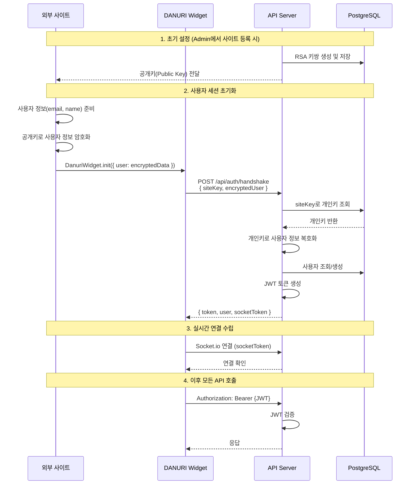
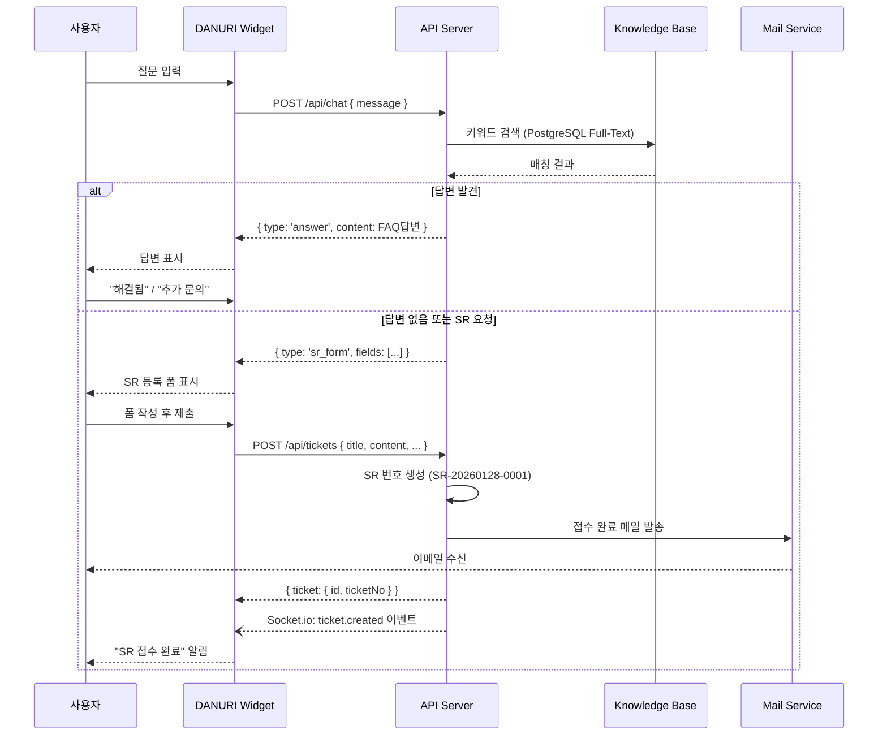

# DANURI 프로젝트 아키텍처 설계 계획

## 개요
'임베더블 AI 챗봇 & 통합 관제 시스템'으로 전면 재설계

---

## 1. 프로젝트 폴더 구조

```
danuri-solution/
├── README_DEV.md                 # 개발자용 상세 아키텍처 문서
├── docs/                         # 추가 문서
│   └── diagrams/                 # 시퀀스 다이어그램 등
│
├── packages/
│   ├── widget/                   # 임베더블 챗봇 위젯 (Client SDK)
│   │   ├── src/
│   │   │   ├── index.js          # 진입점
│   │   │   ├── core/
│   │   │   │   ├── widget.js     # 위젯 코어 로직
│   │   │   │   ├── chat.js       # 채팅 UI/로직
│   │   │   │   └── crypto.js     # RSA 암호화 (공개키)
│   │   │   ├── api/
│   │   │   │   └── client.js     # API 통신 클라이언트
│   │   │   ├── socket/
│   │   │   │   └── realtime.js   # Socket.io 클라이언트
│   │   │   └── styles/
│   │   │       └── widget.css    # 위젯 스타일
│   │   ├── dist/                 # 빌드 결과물
│   │   │   └── danuri-widget.js  # 배포용 번들
│   │   ├── rollup.config.js      # 번들러 설정
│   │   └── package.json
│   │
│   ├── api-server/               # 백엔드 API 서버 (Node.js/Feathers.js)
│   │   ├── src/
│   │   │   ├── app.js            # Feathers 앱 진입점
│   │   │   ├── services/
│   │   │   │   ├── sites/        # 외부 사이트(Tenant) 관리
│   │   │   │   ├── api-keys/     # 공개키/개인키 관리
│   │   │   │   ├── tickets/      # SR(티켓) CRUD
│   │   │   │   ├── knowledge/    # FAQ/지식베이스
│   │   │   │   ├── auth/         # 인증 (JWT 발급)
│   │   │   │   └── mail/         # 아웃바운드 메일
│   │   │   ├── hooks/            # Feathers 훅
│   │   │   ├── middleware/
│   │   │   │   └── decrypt.js    # RSA 복호화 미들웨어
│   │   │   ├── channels.js       # Socket.io 실시간 채널
│   │   │   └── models/           # Sequelize/Knex 모델
│   │   │       ├── sites.js
│   │   │       ├── api-keys.js
│   │   │       ├── tickets.js
│   │   │       ├── knowledge.js
│   │   │       └── users.js
│   │   ├── migrations/           # DB 마이그레이션
│   │   ├── seeds/                # 초기 데이터
│   │   ├── config/
│   │   │   ├── default.json
│   │   │   └── production.json
│   │   └── package.json
│   │
│   └── admin-server/             # 관리자 시스템 (eGovFrame/Spring Boot)
│       ├── src/
│       │   └── main/
│       │       ├── java/
│       │       │   └── kr/go/danuri/admin/
│       │       │       ├── DanuriAdminApplication.java
│       │       │       ├── controller/
│       │       │       │   ├── DashboardController.java
│       │       │       │   ├── TicketController.java
│       │       │       │   └── SiteController.java
│       │       │       ├── service/
│       │       │       ├── repository/
│       │       │       ├── dto/
│       │       │       └── config/
│       │       │           └── SecurityConfig.java
│       │       └── resources/
│       │           ├── templates/    # Thymeleaf 템플릿
│       │           │   ├── layout/
│       │           │   ├── dashboard/
│       │           │   ├── tickets/
│       │           │   └── sites/
│       │           ├── static/
│       │           │   ├── css/
│       │           │   └── js/
│       │           └── application.yml
│       ├── build.gradle
│       └── pom.xml               # eGovFrame Maven 설정
│
├── docker/
│   ├── docker-compose.yml        # 로컬 개발환경
│   ├── docker-compose.prod.yml   # 프로덕션
│   ├── widget.Dockerfile
│   ├── api.Dockerfile
│   └── admin.Dockerfile
│
├── scripts/
│   ├── generate-keys.js          # RSA 키쌍 생성 스크립트
│   └── setup-db.sh               # DB 초기화
│
└── .env.example                  # 환경변수 템플릿
```

---

## 2. 핵심 컴포넌트 설계

### 2.1 임베더블 위젯 (Widget/SDK)

**기술 스택:**
- Vanilla JS (No Framework)
- Rollup (번들러)
- Socket.io-client

**배포 방식:**
```html
<script src="https://cdn.danuri.go.kr/widget/danuri-widget.js"></script>
<script>
  DanuriWidget.init({
    siteKey: 'SITE_PUBLIC_KEY',
    user: {
      email: 'encrypted_user_email',
      name: 'encrypted_user_name'
    }
  });
</script>
```

### 2.2 API 서버 (Node.js/Feathers.js)

**기술 스택:**
- Feathers.js v5
- PostgreSQL + Knex
- Socket.io
- Node-RSA / crypto

**핵심 서비스:**
| 서비스 | 엔드포인트 | 설명 |
|--------|------------|------|
| sites | `/api/sites` | 외부 사이트(Tenant) 관리 |
| api-keys | `/api/keys` | RSA 키쌍 관리 |
| tickets | `/api/tickets` | SR 생성/조회/수정 |
| knowledge | `/api/knowledge` | FAQ 키워드 검색 |
| auth | `/api/auth` | JWT 인증 |

### 2.3 관리자 시스템 (Admin)

**기술 스택:**
- eGovFrame 4.x (Spring Boot 기반)
- Thymeleaf
- Bootstrap 5

**주요 화면:**
- 대시보드: 전체 SR 현황 (사이트별 통계)
- 티켓 관리: SR 목록/상세/처리
- 사이트 관리: 외부 사이트 등록/API 키 발급

---

## 3. 데이터베이스 스키마 (PostgreSQL)

```sql
-- 외부 사이트(Tenant) 관리
CREATE TABLE sites (
    id UUID PRIMARY KEY DEFAULT gen_random_uuid(),
    name VARCHAR(100) NOT NULL,
    domain VARCHAR(255) NOT NULL UNIQUE,
    status VARCHAR(20) DEFAULT 'active',
    created_at TIMESTAMP DEFAULT NOW(),
    updated_at TIMESTAMP DEFAULT NOW()
);

-- API 키 (RSA 키쌍) 관리
CREATE TABLE api_keys (
    id UUID PRIMARY KEY DEFAULT gen_random_uuid(),
    site_id UUID REFERENCES sites(id) ON DELETE CASCADE,
    public_key TEXT NOT NULL,
    private_key TEXT NOT NULL,  -- 암호화 저장
    status VARCHAR(20) DEFAULT 'active',
    expires_at TIMESTAMP,
    created_at TIMESTAMP DEFAULT NOW()
);

-- 사용자 (챗봇 이용자)
CREATE TABLE users (
    id UUID PRIMARY KEY DEFAULT gen_random_uuid(),
    site_id UUID REFERENCES sites(id),
    email VARCHAR(255) NOT NULL,
    name VARCHAR(100),
    created_at TIMESTAMP DEFAULT NOW(),
    UNIQUE(site_id, email)
);

-- SR(티켓)
CREATE TABLE tickets (
    id UUID PRIMARY KEY DEFAULT gen_random_uuid(),
    site_id UUID REFERENCES sites(id),
    user_id UUID REFERENCES users(id),
    ticket_no VARCHAR(20) UNIQUE NOT NULL,  -- SR-20260128-0001
    title VARCHAR(200) NOT NULL,
    content TEXT,
    category VARCHAR(50),
    status VARCHAR(20) DEFAULT 'pending',   -- pending/in_progress/resolved/closed
    priority VARCHAR(10) DEFAULT 'medium',  -- low/medium/high/urgent
    assigned_to UUID,
    resolved_at TIMESTAMP,
    created_at TIMESTAMP DEFAULT NOW(),
    updated_at TIMESTAMP DEFAULT NOW()
);

-- 지식베이스 (FAQ)
CREATE TABLE knowledge (
    id UUID PRIMARY KEY DEFAULT gen_random_uuid(),
    site_id UUID REFERENCES sites(id),  -- NULL이면 공통
    question TEXT NOT NULL,
    answer TEXT NOT NULL,
    keywords TEXT[],  -- 검색용 키워드 배열
    hit_count INT DEFAULT 0,
    created_at TIMESTAMP DEFAULT NOW()
);

-- 티켓 이력
CREATE TABLE ticket_history (
    id UUID PRIMARY KEY DEFAULT gen_random_uuid(),
    ticket_id UUID REFERENCES tickets(id) ON DELETE CASCADE,
    action VARCHAR(50),
    old_value JSONB,
    new_value JSONB,
    created_by UUID,
    created_at TIMESTAMP DEFAULT NOW()
);
```

---

## 4. 보안 핸드셰이크 시퀀스 (RSA 암호화)



---

## 5. 챗봇 인터랙션 시퀀스



---

## 6. 구현 순서 (권장)

### Phase 1: 기반 구축
1. 모노레포 구조 설정 (packages/)
2. PostgreSQL 스키마 생성 및 마이그레이션
3. API 서버 기본 골격 (Feathers.js)
4. RSA 키 생성/관리 서비스

### Phase 2: 핵심 기능
5. 인증 핸드셰이크 구현
6. 지식베이스 서비스 (키워드 검색)
7. 티켓(SR) CRUD 서비스
8. Socket.io 실시간 채널

### Phase 3: 클라이언트
9. 위젯 SDK 개발 (Vanilla JS)
10. 아웃바운드 메일 서비스

### Phase 4: 관리자
11. eGovFrame Admin 기본 골격
12. 대시보드/티켓/사이트 관리 화면

### Phase 5: 배포
13. Docker 컨테이너화
14. CI/CD 파이프라인

---

## 7. 승인 요청 항목

위 설계를 기반으로 `README_DEV.md` 문서를 생성하고 프로젝트 폴더 구조를 구성할 예정입니다.

- [ ] 폴더 구조 승인
- [ ] DB 스키마 승인
- [ ] 보안 핸드셰이크 로직 승인
- [ ] 구현 순서 승인
